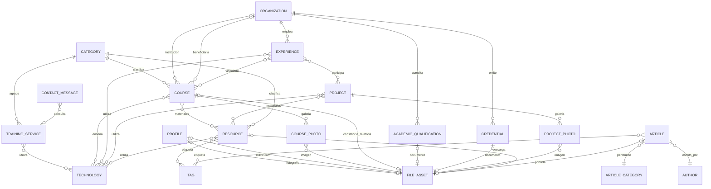

# Arquitectura y modelo de datos

## Decisiones de base

Monolito modular con Django 5.2 LTS y renderizado en servidor. Las plantillas Django, CSS y JavaScript propios evitan incorporar un framework frontend o una cadena de compilación innecesaria para una portada de contenido. SQLite facilita la instalación en Windows; PostgreSQL será la base de producción. Gunicorn ejecutará Django detrás de Nginx en Linux.

El dominio y las credenciales proceden del entorno. Los archivos se almacenan de forma privada; su acceso público se autoriza por registro. La primera entrega establece modelos principales, administrador y portada. Las aplicaciones posteriores se incorporarán con migraciones y verificaciones; no se presentan módulos vacíos como funcionalidades terminadas.

| Aplicación | Responsabilidad | Entrega |
| --- | --- | --- |
| `core` | Perfil, configuración, organizaciones, tecnologías y archivos | Etapa 1 |
| `training` | Categorías y servicios; después cursos y galerías | Base en etapa 1; catálogo en etapa 3 |
| `experience` | Trayectoria laboral y docente | Etapa 2 |
| `education` | Formación, diplomados y certificaciones obtenidas | Etapa 2 |
| `portfolio` | Proyectos y galerías | Etapa 4 |
| `resources` | Recursos educativos, licencias y descargas | Etapa 4 |
| `blog` | Artículos, etiquetas y URLs individuales | Etapa 4 |
| `contact` | Mensajes, antispam y avisos por correo | Etapa 5 |

## Modelo implementado en la etapa 1

- **Perfil:** nombre, título, presentación, biografía tecnológica y docente, metodología, ubicación, cobertura y enlaces de contacto. Fotografía y currículum opcionales. Un único perfil representa al titular.
- **Configuración:** nombre del sitio y textos de posicionamiento. El dominio canónico procede de `SITE_URL`.
- **Organización:** entidad compartida para instituciones, OTEC, empleadores y empresas, evitando duplicaciones por curso.
- **Tecnología:** catálogo agrupable que podrá asociarse a servicios, cursos, experiencias, proyectos y recursos.
- **Categoría:** área temática y orden de aparición.
- **Servicio:** nombre, descripción, categoría, icono, tecnologías, orden y visibilidad. Representa una oferta, no una relatoría efectuada.
- **Archivo:** documento o imagen con título, metadatos y autorización de publicación. La carga no concede acceso público automático.

Los registros conservan fechas de creación y modificación cuando corresponde. Las relaciones editoriales deben protegerse frente a eliminaciones accidentales. Admin permite búsqueda, filtros y orden donde aportan valor.

## Modelo relacional de la plataforma completa

El diagrama también incluye entidades previstas para etapas futuras; no significa que esos módulos ya estén implementados.



Las relaciones opcionales permiten guardar datos parciales sin inventar fechas, horas o documentos. Las categorías temáticas se compartirán entre cursos y recursos; las categorías editoriales tendrán una responsabilidad separada. Las galerías usarán entidades intermedias con orden y texto alternativo.

### Reglas de siguientes etapas

**Currículum:** experiencias con cargo, organización, fechas y responsabilidades. Se distinguirá fecha desconocida de cargo vigente. Títulos académicos y credenciales obtenidas permanecerán separados de cursos impartidos. Un año documentado no se convertirá en una fecha exacta supuesta.

**Relatorías:** cada realización registrará institución, beneficiario opcional, fechas, duración, modalidad, ubicación y estado. `Programado` nunca contará como `finalizado`. Los títulos mencionados en el encargo no permiten inventar instituciones, fechas ni horas. Fotografías, recursos y tecnologías tendrán asociaciones múltiples.

**Contenido:** recursos con archivo o enlace, licencia y estado de publicación; solo podrán enlazar archivos autorizados. Artículos con borrador/publicado, contenido sanitizado, autor y etiquetas. Recursos y artículos tendrán URLs individuales y resúmenes en portada.

**Contacto:** mensajes con nombre, organización, correo, teléfono opcional, área, contenido y estado de atención. Se almacenarán antes de intentar SMTP para no perder consultas por fallos de correo. Se definirán límites de frecuencia y retención.

**Indicadores:** se calcularán desde registros documentados y publicados. Las horas solo sumarán realizaciones finalizadas con duración conocida; los cursos no se mezclarán con servicios. Sin evidencia suficiente no habrá indicador. Los años de trayectoria requerirán criterios que eviten duplicar periodos solapados.

## Estructura visual

Fondo marino, superficies claras, acentos azul y cian, tipografía de sistema y SVG coherentes. Espaciado amplio, jerarquía clara y llamadas a la contratación sin cifras no acreditadas. Sin fotografía real se utiliza una composición de iniciales, nunca el retrato de otra persona.

| Orden | Identificador | Contenido |
| --- | --- | --- |
| 1 | `inicio` | Nombre, título, presentación y llamadas a experiencia y capacitación; CV solo si es público |
| 2 | `sobre-mi` | Trayectoria tecnológica y docente; metodología |
| 3 | `servicios` | Áreas ofrecidas, administradas en base de datos |
| 4 | `cursos` | Relatorías, filtros y carga progresiva en etapa 3 |
| 5 | `experiencia` | Cronología profesional en etapa 2 |
| 6 | `formacion` | Formación académica en etapa 2 |
| 7 | `credenciales` | Diplomados y certificaciones obtenidas en etapa 2 |
| 8 | `tecnologias` | Competencias por categorías, sin porcentajes arbitrarios |
| 9 | `proyectos` | Proyectos documentados en etapa 4 |
| 10 | `recursos` | Biblioteca educativa en etapa 4 |
| 11 | `publicaciones` | Contenido técnico en etapa 4 |
| 12 | `contacto` | Enlaces de contacto; formulario en etapa 5 |

Las secciones sin registros presentan estados vacíos discretos. La navegación fija usa enlaces internos y un menú móvil accesible. Foco visible, contraste y movimiento reducido forman parte de la base. Los textos profesionales proceden de la base de datos.

## Privacidad y seguridad

Los adjuntos son privados salvo autorización expresa. Antes de publicar certificados, preparar una copia sin RUT, firmas, códigos privados o datos de terceros. Esa revisión es humana: la plataforma no realiza anonimización automática.

Las cargas limitan tamaño y formato y comprueban su contenido. Una vista Django aplica el permiso de publicación en cada descarga; Nginx no tendrá un alias al almacenamiento privado. El contenido enriquecido se sanitiza antes de renderizarse. Se mantienen autenticación Admin, CSRF, secretos fuera de Git y settings endurecidos para producción.

## Estructura

```text
config/                 # URLs, WSGI y settings por entorno
core/                   # Perfil, entidades compartidas, archivos y portada
training/               # Categorías y servicios; cursos en etapa posterior
templates/              # Base y componentes
static/                 # CSS, JavaScript e iconografía local
docs/                   # Arquitectura, aceptación y despliegue
manage.py
requirements.txt
.env.example
```

Las otras aplicaciones se crearán en su etapa. Las migraciones se versionan; la base local, el entorno virtual, los archivos cargados y los secretos quedan fuera de Git.
